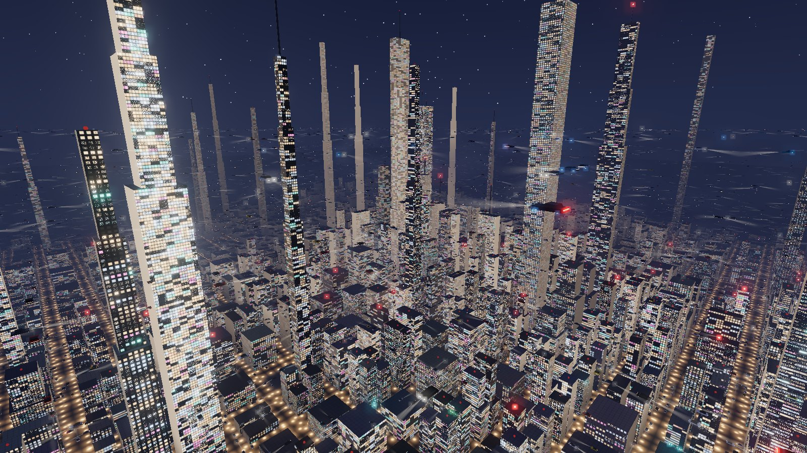
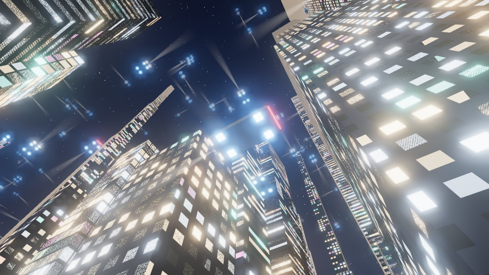
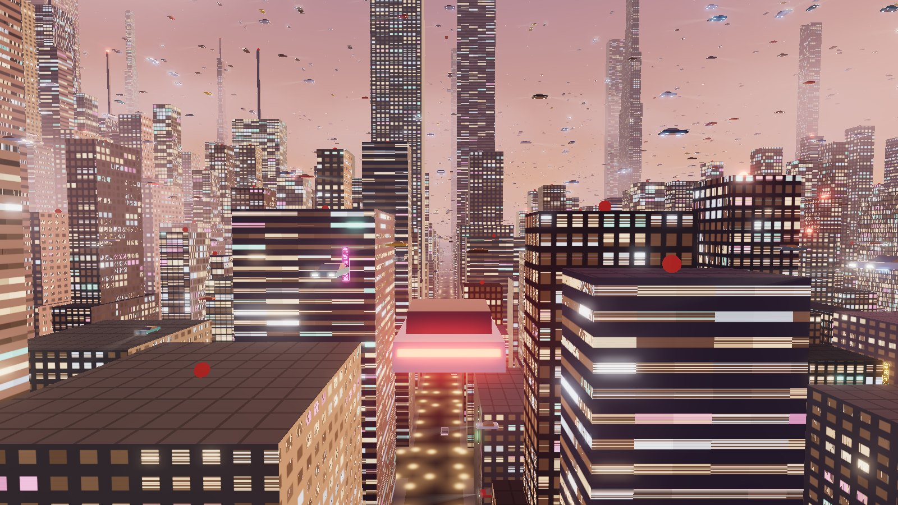
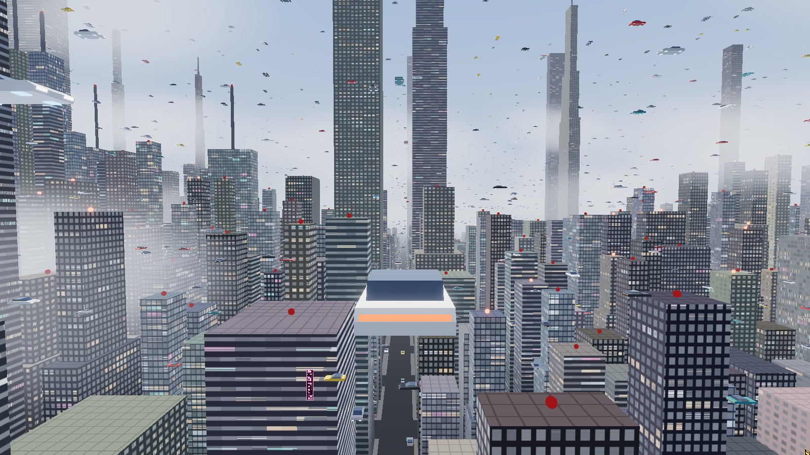
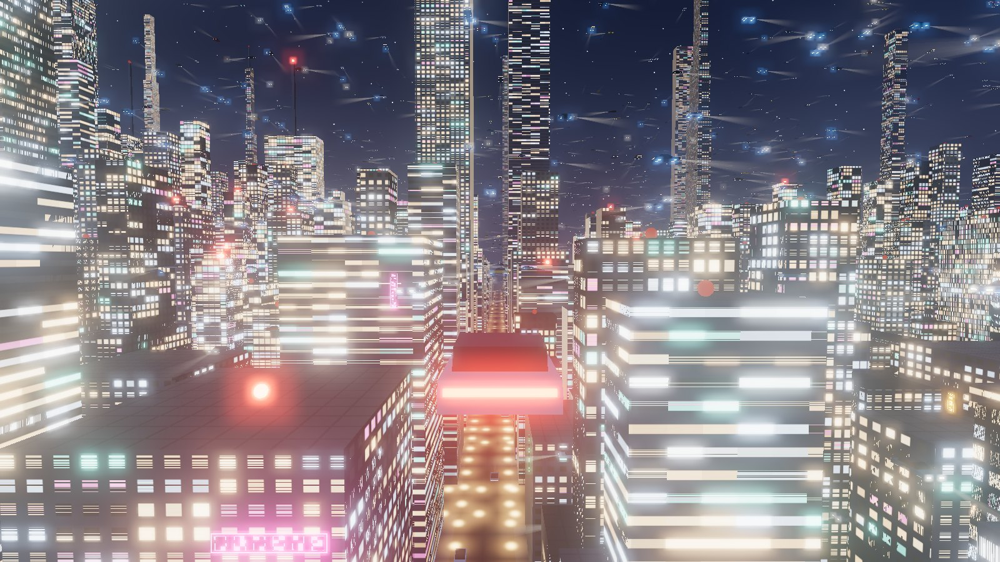

<div align="center">



# NEON SPRAWL

**One seed. One city. Sixteen thousand flying cars.**<br>
숫자 하나를 넣으면 타워 2천여 개와 비행차 1만 6천 대가 사는 사이버펑크 도시가 펼쳐집니다. 브라우저에서 바로 날아다닐 수 있습니다.

[](https://jeiel85.github.io/neon-sprawl/)
[](https://jeiel85.github.io/neon-sprawl/app/#seed=4417&sky=night&view=chase)


</div>

---

## 한눈에 보기

| | |
| --- | --- |
|  |  |
| **Night, Director 카메라** — 차 아래에서 올려다보는 컷 | **Dusk, Chase 카메라** — 노을 속 협곡 비행 |
|  |  |
| **Day** — 유리 외벽, 안개, 낮은 구름 | **Night** — 전조등 빔과 네온 |

## 특징

- 🌱 **시드 하나로 생성** — 30 × 30 격자의 필지마다 노이즈 필드와 도심 거리로 높이·셋백·첨탑·외벽 스타일을 정합니다. 같은 시드는 언제나 같은 도시입니다.
- 🚗 **GPU가 모는 교통** — 16,000대 전부를 차선·속도·위상만으로 정점 셰이더가 매 프레임 배치합니다. 차체와 전조등 빔을 합쳐 드로우 콜 2번입니다.
- 🪟 **텍스처 없는 창문 ~140만 개** — 프래그먼트 셰이더가 창문 격자를 그리고, 방 단위 해시로 불을 켭니다. 멀리 있는 격자는 평균색으로 섞여 모아레가 생기지 않습니다.
- 🎥 **카메라 4종 + 자유 시점** — Chase · Seat · Drone · Director. 추적·운전석 시점에서도 드래그로 둘러보고 휠로 당기고 밀 수 있습니다.
- 🌇 **하늘 3종** — Day · Dusk · Night. 해, 안개, 불 켜진 방 비율, 블룸 세기가 부드럽게 전환됩니다.
- ⚙️ **그래픽 품질** — Auto · Fast · High · Ultra. Auto는 프레임레이트를 보고 렌더 해상도를 스스로 조절합니다.
- 🎬 **필름 모드와 일시정지** — UI를 걷어 내고 레터박스로 감상하거나, 도시 전체를 멈춘 채 카메라만 돌려 볼 수 있습니다.
- 🔗 **URL이 곧 저장 파일** — 시드·하늘·카메라·위치·방향·품질이 주소창에 기록되어 링크만 보내면 같은 장면이 열립니다.

## 조작

| 입력 | 동작 |
| :---: | --- |
| <kbd>W</kbd> <kbd>S</kbd> | 상승 / 하강 |
| <kbd>A</kbd> <kbd>D</kbd> | 도로 폭 안에서 좌우로 기울여 이동 |
| <kbd>Q</kbd> <kbd>E</kbd> | 차 주위로 카메라 궤도 회전 |
| <kbd>⇧</kbd> <kbd>T</kbd> | 터보 토글 |
| <kbd>⇧</kbd> <kbd>H</kbd> | 호버(정지) 토글 |
| <kbd>⇧</kbd> <kbd>V</kbd> | 운전석 시점 토글 |
| <kbd>C</kbd> | 필름 모드 (<kbd>Esc</kbd>로 해제) |
| <kbd>R</kbd> | 시점 초기화 |
| <kbd>Space</kbd> | 일시정지 |
| 드래그 | 둘러보기 (Drone에서는 궤도 회전, 우클릭 드래그는 이동) |
| 휠 | 확대 / 축소 |
| 차 클릭 / 탭 | 그 차로 갈아타 추적 |

오른쪽 위 **Controls** 패널은 처음에만 열려 있다가, 비행을 시작하면(캔버스 클릭·드래그·휠, 조종 키) 저절로 접힙니다. 버튼을 누르면 다시 열립니다.

내 차는 손을 떼도 협곡을 따라 스스로 날고 교차로에서 방향을 틉니다. 도시 끝에 닿기 전에는 반드시 돌아섭니다.

## URL 파라미터

```
app/#seed=4417&sky=night&view=chase&at=825.3,145.3,849.0&look=119,-5&traffic=70&gfx=high
```

| 키 | 값 | 설명 |
| --- | --- | --- |
| `seed` | `0`–`99999` | 도시 시드. 없으면 무작위 |
| `sky` | `day` · `dusk` · `night` | 하늘 |
| `view` | `chase` · `seat` · `drone` · `director` | 카메라 |
| `at` | `x,y,z` | 위치 (drone은 카메라, 그 외는 내 차) |
| `look` | `yaw,pitch` | 바라보는 방향(도) |
| `traffic` | `0`–`100` | 교통량 %. 기본 70이면 생략 |
| `gfx` | `auto` · `fast` · `high` · `ultra` | 그래픽 품질. 기본 auto면 생략 |

## 로컬 실행

빌드 과정이 없는 정적 사이트입니다. ES 모듈을 쓰므로 `file://` 대신 정적 서버로 띄우세요.

```bash
git clone https://github.com/jeiel85/neon-sprawl.git
cd neon-sprawl
python -m http.server 5180 --bind 127.0.0.1
```

`http://127.0.0.1:5180/` 이 랜딩 페이지, `http://127.0.0.1:5180/app/` 이 도시입니다. three.js와 폰트는 CDN에서 받으므로 인터넷 연결이 필요합니다.

## 구조

```
neon-sprawl/
├── index.html          랜딩 페이지 (GitHub Pages 루트)
├── assets/             스크린샷
└── app/
    ├── index.html      도시 앱 + HUD/패널
    ├── style.css
    └── src/
        ├── rng.js      시드 RNG(mulberry32), value noise
        ├── city.js     격자·필지·타워/네온/경고등/지면
        ├── traffic.js  차선·차량 생성, 인스턴싱, CPU 위치 계산
        ├── shaders.js  모든 GLSL (창문, 안개, 차량 배치)
        ├── sky.js      하늘 프리셋, 별·구름, 전환 보간
        ├── hero.js     내 차 자동 비행과 키 조작
        ├── cameras.js  카메라 4종, 드래그·궤도·줌
        └── main.js     렌더러·블룸·품질·UI·입력·URL 해시
```

### 고칠 때 주의할 점

- 차량 위치는 셰이더(`CAR_PLACE`)가 계산하고, 클릭 선택과 Director 카메라는 `traffic.carPos()`가 같은 식을 CPU에서 재현합니다. **두 식은 항상 같이** 고쳐야 합니다.
- 창문 셀 크기는 `city.js`의 `CELLS`(창 개수 통계)와 `shaders.js`의 `cellFor()`(렌더링)에 중복되어 있습니다.
- 브라우저 콘솔의 `window.neonSprawl`로 실행 중인 상태(`hero`, `world`, `camera` 등)를 볼 수 있습니다.

## 크레딧

[sael.net/gigacity](https://sael.net/gigacity/)에서 영감을 받아 처음부터 새로 구현했습니다. 렌더링은 [three.js](https://threejs.org/)를 씁니다.
